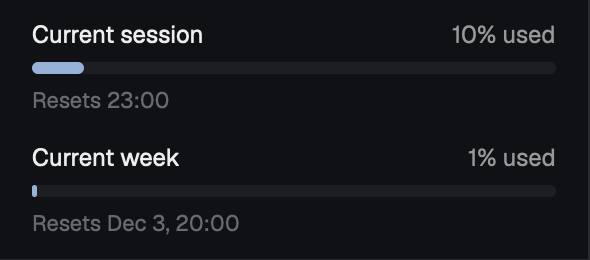
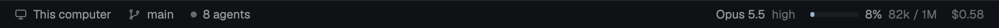

# herdr-plugins

Mods for the [Herdr](https://herdr.dev) desktop app that keep an eye on your
Claude Code sessions: how much of your usage limits is left, and what the
session in front of you is running on.

<p align="center">
  
</p>
<p align="center">
  
</p>

## Plugins

| Plugin | Where | What it shows |
|---|---|---|
| [claude-usage](claude-usage/) | Left sidebar | How much of your Claude Code 5-hour and weekly limits is used, and when each resets |
| [claude-context](claude-context/) | Bottom bar, right | The focused session's model, effort, context window fill and estimated cost |
| [workspace-status-lite](workspace-status-lite/) | Bottom bar, left | Herdr's own bottom bar without the "⌘⇧P commands" hint, leaving room for claude-context |
| [pull-requests](pull-requests/) | Side panel, right | The GitHub PRs or GitLab MRs of the focused pane's branch, with pipeline, approvals and state |

claude-usage and claude-context each come in two parts: a Claude Code plugin
that saves the figures under `~/.cache` after every turn, and a Herdr mod that
reads them. Your Claude Code status line isn't touched.

## Install everything

You need the Herdr desktop app, Claude Code and `jq`. Each plugin's README
covers installing it on its own.

**1. The Claude Code plugins.** From a clone of this repo:

```sh
claude plugin marketplace add "$PWD"
claude plugin install herdr-claude-usage@herdr-plugins
claude plugin install herdr-claude-context@herdr-plugins
```

or at the prompt of a Claude Code session, straight from GitHub:

```
/plugin install herdr-claude-usage --marketplace HenriBeck/herdr-plugins
/plugin install herdr-claude-context --marketplace HenriBeck/herdr-plugins
```

Sessions that were already open pick them up after a restart or
`/reload-plugins`.

**2. The Herdr mods.** Each script copies its mod into
`~/.config/herdr-app/mods` and runs `herdr-app check` on it:

```sh
./claude-usage/install.sh
./claude-context/install.sh
./workspace-status-lite/install.sh
./pull-requests/install.sh
```

**3. A layout that shows them.** Clone Herdr's `main` layout as `main-usage`,
then add the usage card above the sidebar footer, swap in the lite bottom bar
and put claude-context beside it:

```sh
herdr-app do layout.clone '{"name":"main","as":"main-usage"}'
layout=~/.config/herdr-app/layouts/main-usage.json

jq '(.. | objects | select(.id == "sidebar") | .children) |= [ .[] | if .id == "sidebar-footer"
    then ({"id":"claude-usage","type":"block","size":{"px":132},"content":{"mod":"claude-usage"}}, .) else . end ]' \
  "$layout" > /tmp/l.json && mv /tmp/l.json "$layout"

jq '(.. | objects | select(.id == "status") | .content.mod) = "workspace-status-lite"' \
  "$layout" > /tmp/l.json && mv /tmp/l.json "$layout"

jq '(.. | objects | select(.id == "work") | .children) |= [ .[] | if .id == "status"
    then {"id":"status-row","type":"row","size":{"px":28},"children":[(.size = {"weight":1}),
      {"id":"claude-context","type":"block","size":{"px":360},"content":{"mod":"claude-context"}}]}
    else . end ]' \
  "$layout" > /tmp/l.json && mv /tmp/l.json "$layout"
```

`layout.clone` switches to the new layout. `main-usage` is a clone, so it doesn't receive Herdr's future changes to
`main`. `ctrl-shift-l` switches layouts.

## Development

Edit a mod in its `mod/` folder, then re-run its `install.sh`: Herdr
hot-reloads files saved inside its mods folder, but not edits made through a
symlink. Claude Code plugin edits are picked up by `/reload-plugins`.

```sh
claude plugin test claude-usage/claude-code-mod
claude plugin test claude-context/claude-code-mod
node --test claude-usage/mod/ claude-context/mod/ pull-requests/mod/
```

Screenshots come from `herdr-app shot`, cropped to the mod.
