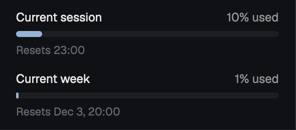

# claude-usage

A card in the Herdr desktop app's left sidebar showing how much of your Claude
Code **5-hour** (session) and **weekly** limits is used, and when each resets,
worded like Claude Code's `/usage`.



Bars turn orange from 75% used and red from 90%. With the sidebar collapsed it
shows the two percentages; hover them for the details.

## How it works

Two parts:

- **`claude-code-mod/`**: a Claude Code plugin (`herdr-claude-usage`). Claude
  Code measures your 5-hour and weekly limits after every turn, and its
  `session.measure` hook saves them to `~/.cache/herdr-claude-usage.json`.
  Every open session reports its own last snapshot, so the mod merges per
  window: a later reset wins, then the higher usage. Your status line isn't
  touched.
- **`mod/`**: the Herdr mod. It reads that file every 15 s and redraws once a
  minute. Numbers only refresh while a Claude Code session is running; a
  window whose reset time has passed shows as 0% used, "Reset".

## Install

The Claude Code plugin, from a clone of this repo (edits are picked up by
`/reload-plugins`):

```sh
claude plugin marketplace add "$PWD"
claude plugin install herdr-claude-usage@herdr-plugins
```

or straight from GitHub, at the prompt of a Claude Code session:

```
/plugin install herdr-claude-usage --marketplace HenriBeck/herdr-plugins
```

Sessions that were already open pick it up after a restart or `/reload-plugins`.

The Herdr card:

```sh
./claude-usage/install.sh   # copies the mod into Herdr and runs herdr-app check; re-run after edits

# Your own copy of the shipped layout, with the card above the sidebar footer
herdr-app do layout.clone '{"name":"main","as":"main-usage"}'
jq '(.. | objects | select(.id == "sidebar") | .children) |= [ .[] | if .id == "sidebar-footer"
    then ({"id":"claude-usage","type":"block","size":{"px":132},"content":{"mod":"claude-usage"}}, .) else . end ]' \
  ~/.config/herdr-app/layouts/main-usage.json > /tmp/l.json && mv /tmp/l.json ~/.config/herdr-app/layouts/main-usage.json
```

`main-usage` is a clone, so it doesn't receive Herdr's future changes to
`main`. `ctrl-shift-l` switches layouts.

## Uninstall

```sh
claude plugin uninstall herdr-claude-usage@herdr-plugins
herdr-app do layout.switch '{"name":"main"}'
rm -r ~/.config/herdr-app/layouts/main-usage.json ~/.config/herdr-app/mods/claude-usage
rm -f ~/.cache/herdr-claude-usage.json
```

## Tests

```sh
claude plugin test claude-usage/claude-code-mod
node --test claude-usage/mod/
```

`HERDR_CLAUDE_USAGE_FILE` overrides where the Claude Code plugin saves the
data file.
